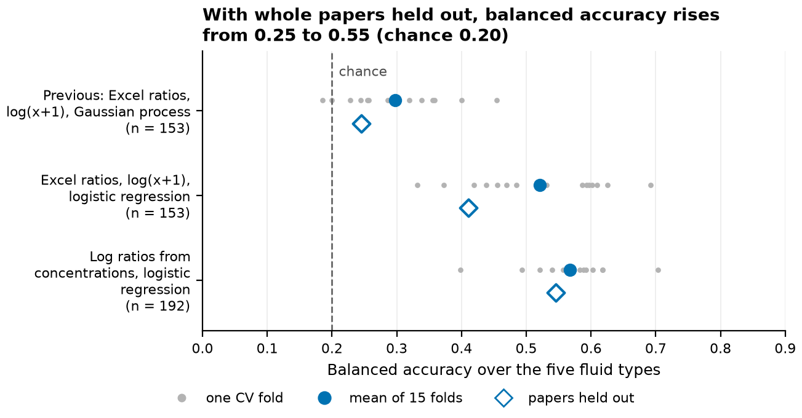
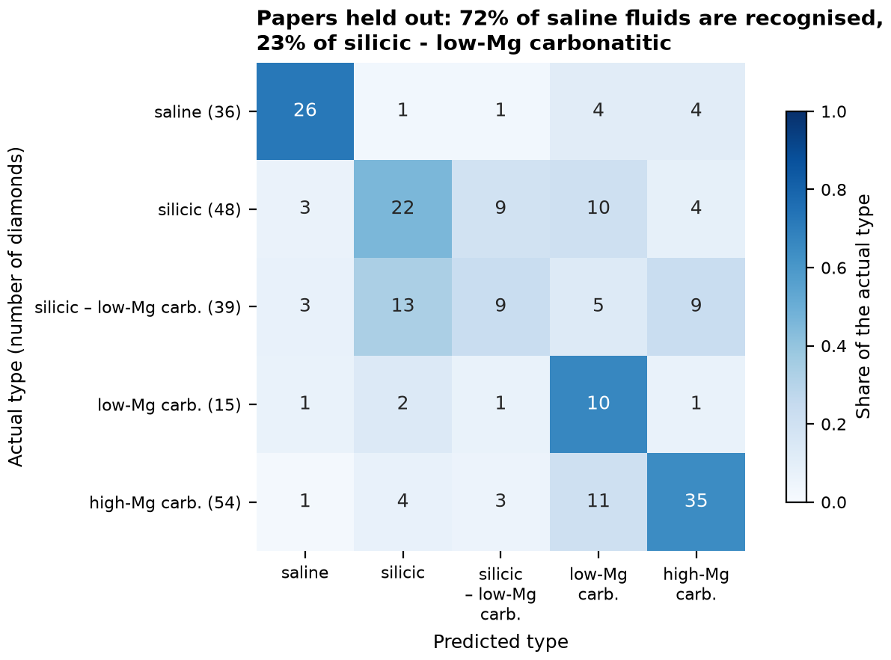
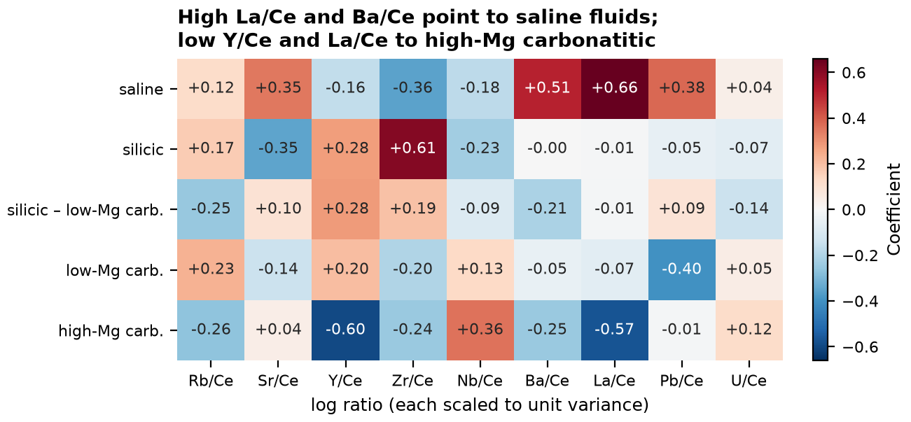
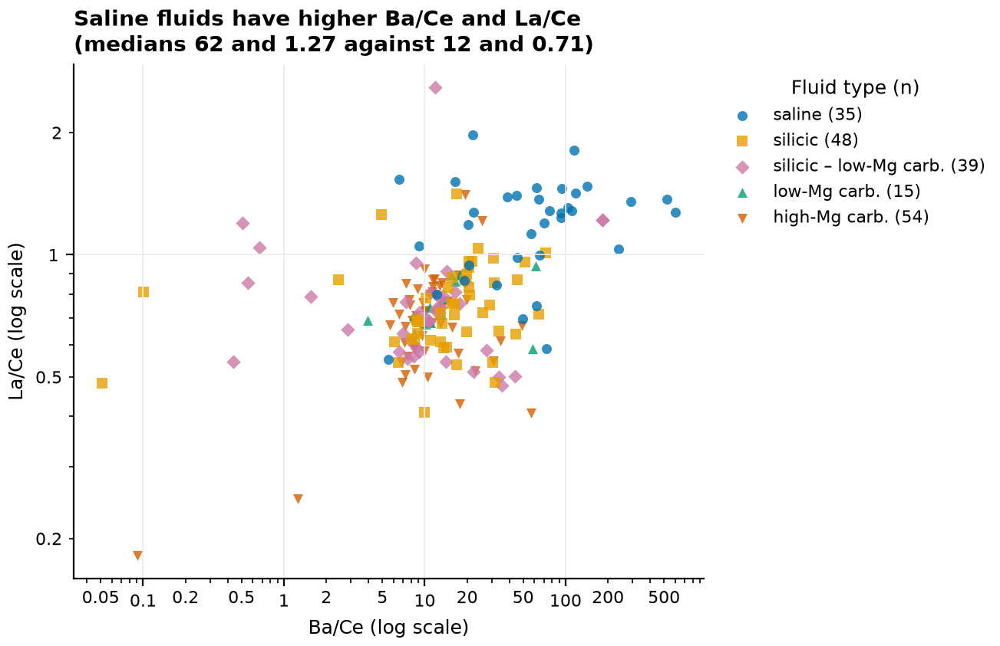
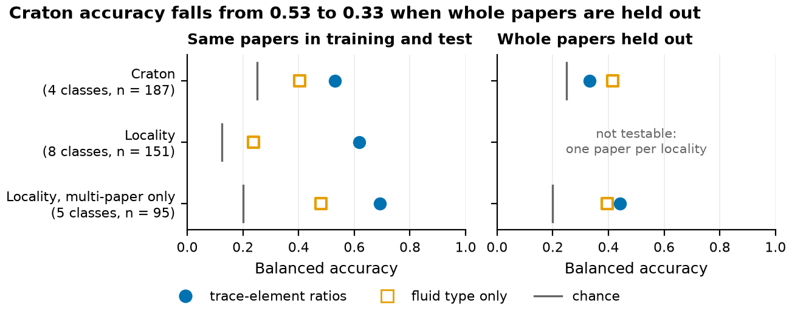

# Diamond fluids

Fibrous diamonds trap the high-density fluids they grew from as microinclusions. Weiss et al. (2022) group these fluids into five types using their major elements (SiO2, MgO, CaO and Cl). Electron microprobe measures those elements; LA-ICP-MS, which can analyse the fluid in twinning wisps, cannot measure Cl well. This repository asks how well trace-element ratios that LA-ICP-MS can measure recover the fluid type, and whether they also record where a diamond came from.

The data are the global compilation of fibrous-diamond fluid compositions published with Weiss et al. (2022). Each row is one diamond, averaged over at least 10 microinclusions. Of the 313 diamonds with a fluid type, 192 have enough trace-element data to use: three or more of the nine ratios below.

This is a working research repository. The LA-ICP-MS map processing and other early analyses are in [exploratory/](exploratory/).

## Results

### Fluid type

The classifier uses nine log ratios, log(element/Ce) for Rb, Sr, Y, Zr, Nb, Ba, La, Pb and U, computed from the concentration columns. A logistic regression weights the five types equally, so the largest type (high-Mg carbonatitic) does not dominate.

Scores are balanced accuracy (the mean of the per-type recall), where guessing scores 0.20. Two tests are reported. Stratified cross-validation mixes diamonds from the same paper into training and test. Holding out whole papers is harder: each paper is one lab, one analytical method and usually one locality. It is the better guide to how the model will do on new measurements from another lab.



*Balanced accuracy for three versions of the pipeline. Grey dots are the 15 folds of 5-fold cross-validation repeated three times; filled circles are their mean. Open diamonds hold out whole papers (5 groups). The first two rows use the 153 diamonds with all twelve of the compilation's ratio columns.*

With papers held out, balanced accuracy rose from 0.25 to 0.55 through three fixes:

1. The earlier Gaussian process classifier was close to guessing. On its own 25% test split it labelled 35 of the 39 diamonds high-Mg carbonatitic, and its optimizer did not converge. Logistic regression on the same inputs reaches 0.41 with papers held out.
2. The compilation's ratio columns store a missing numerator as 0. All 66 zeros in Pb/U are diamonds with no Pb analysis, and the same holds for the zeros in Y/La and Nb/La. Computing the ratios from the concentrations keeps these as missing values, which the model fills with the median.
3. The earlier pipeline took log(x + 1). Most of these ratios are well below 1 (the median U/Sr is 0.005), and there log(x + 1) is close to x, so it squashed them together. A plain log spreads them out.

Stratified cross-validation scores the current model at 0.57 ± 0.07 (mean ± SD over folds). The scripts print one 5-fold split, which gives 0.58.



*Predictions for all 192 diamonds, each made by a model that never saw the diamond's paper. Rows are the type from major elements, columns the predicted type; numbers are counts, shading is the share of the row.*

Saline fluids are the easiest to recognise (26 of 36), followed by low-Mg carbonatitic (10 of 15) and high-Mg carbonatitic (35 of 54). The silicic–low-Mg carbonatitic type is the hardest: only 9 of 39 are right, and most of the rest go to silicic (13) or high-Mg carbonatitic (9). That type is defined as 20 to 40 wt% SiO2, a slice through a continuous range between silicic and carbonatitic fluids, so its trace elements overlap both neighbours. Equal weighting has a side effect: the model predicts low-Mg carbonatitic for 40 diamonds, although only 15 are.



*Coefficients of the logistic regression fitted to all 192 diamonds. Each log ratio is scaled to unit variance, so coefficients compare across ratios. Red pushes a diamond toward that type, blue away from it.*

Saline fluids stand out by high La/Ce and Ba/Ce, silicic fluids by high Zr/Ce, and high-Mg carbonatitic fluids by low Y/Ce and La/Ce. Low-Mg carbonatitic fluids have low Pb/Ce.



*Ba/Ce against La/Ce for the 191 diamonds with Ba, La and Ce. Both axes are logarithmic.*

Saline fluids have a median Ba/Ce of 62 and La/Ce of 1.27, against 12 and 0.71 for the other four types, which overlap one another on these two ratios.

Two other approaches did worse in exploratory runs. Adding Th, the middle REE, Cs, K, Ti, Hf and Ta, or adding Mg, Al and Na, lowered the held-out-paper score from 0.52 to 0.44 and 0.42 in the same run. Predicting SiO2, MgO, CaO and Cl from the trace elements and then applying the Weiss et al. thresholds scored about 0.39, because the trace elements explain only 16 to 35% of the variance in those oxides.

### Craton and locality

The two location scripts ask whether trace elements record where a diamond came from. They include only cratons and localities with at least 10 diamonds with trace data. A fair test has to beat a baseline that knows only the fluid type, because the fluid types sampled differ by place: most Slave craton diamonds carry saline fluids, and most Siberian ones carry carbonatitic fluids.



*Balanced accuracy for predicting craton or locality from the nine log ratios (blue circles) and from the fluid type alone (orange squares). Left: stratified 5-fold cross-validation repeated three times (mean of 15 folds). Right: whole papers held out. Grey bars mark chance.*

| Target | Classes | Diamonds | Trace ratios, stratified | Trace ratios, papers held out | Fluid type only, papers held out |
|---|---|---|---|---|---|
| Craton | 4 | 187 | 0.53 | 0.33 | 0.42 |
| Locality | 8 | 151 | 0.62 | not testable | not testable |
| Locality, studied by more than one paper | 5 | 95 | 0.69 | 0.44 | 0.40 |

Craton looks predictable until whole papers are held out. Then the trace-element model falls to 0.33, below the fluid-type baseline (0.42) and close to chance (0.25). The stratified score most likely reflects differences between labs and methods.

Locality cannot be tested this way for all eight localities, because Nyurbinskaya, Ebelyakh and Ekati each come from a single paper. For the five localities studied by more than one paper, accuracy drops from 0.69 to 0.44 when the paper is held out, only slightly better than the 0.40 from fluid type alone.

## Running the analysis

```bash
uv sync
uv run python make_figures.py   # about 15 s; writes figures/*.png and figures/*.csv
```

The three analysis scripts are written as VS Code / Jupyter cells (`#%%`) and can also be run whole with `uv run python <script>`:

- [Fluid_Comp_Analysis.py](Fluid_Comp_Analysis.py) classifies fluid type and clusters the compositions with a Gaussian mixture.
- [Fluid_Comp_Analysis_location Variant.py](Fluid_Comp_Analysis_location%20Variant.py) does the same for craton.
- [Fluid_Comp_Analysis_Mine_Variant.py](Fluid_Comp_Analysis_Mine_Variant.py) does the same for locality (mine).

[hdf_compilation.py](hdf_compilation.py) loads the compilation and builds the log ratios and the classifier for all of them. The environment uses Python 3.12: scipy 1.15, the last release for Python 3.10, does not load on current macOS.

## Layout

| Path | Contents |
|---|---|
| `hdf_compilation.py` | Data loading, log-ratio features, classifier |
| `Fluid_Comp_Analysis*.py` | Fluid type, craton and locality analyses |
| `make_figures.py`, `figures/` | README figures and the tables behind them (`results.csv`, `confusion_held_out_papers.csv`, `coefficients.csv`) |
| `Weiss_et_al-RiMG-Global_Diamond_HDF_compilation_Aug_2021.xlsx` | The compilation (sheet `HDF_Limited_Col`) |
| `exploratory/` | LA-ICP-MS map processing and calibration against reference materials; run its scripts from inside that folder |
| `exploratory/early_results/` | Clustering and classification results from January 2025, from the earlier pipeline |

## Data source

Weiss, Y., Czas, J. and Navon, O. (2022). Fluid inclusions in fibrous diamonds. *Reviews in Mineralogy and Geochemistry* 88, 475-532. https://doi.org/10.1515/9781501517044-009

The fluid types are those in the compilation's "HDF Type (calculated)" column. Weiss et al. assign them from major elements normalised to 100 wt%: saline, Cl ≥ 15 wt%; silicic, SiO2 ≥ 40 wt%; silicic–low-Mg carbonatitic, SiO2 20 to 40 wt% with MgO ≤ 15 wt%; low-Mg carbonatitic, SiO2 ≤ 20 wt%, MgO ≤ 15 wt% and CaO ≥ 15 wt%; high-Mg carbonatitic, SiO2 ≤ 20 wt% and MgO ≥ 15 wt%.

## License

The code is under the MIT License (see LICENSE). The compilation spreadsheet comes from Weiss et al. (2022); cite that paper if you use the data.
